# Creación de fragmentos de contenido

## Creación de contenido con plantillas y fragmentos

**Propósito:** Aprenda a crear fragmentos reutilizables en Adobe Journey Optimizer y, a continuación, aplíquelos dentro de un correo electrónico real dentro de un recorrido.

## Objetivos de aprendizaje

Al final de este módulo, deberá ser capaz de:

1. Desglose los diseños de correo electrónico en fragmentos reutilizables.
1. Cree fragmentos de encabezado, pie de página, banner, cuerpo y CTA.

## Por qué importan los fragmentos

Los fragmentos le permiten crear contenido coherente y alineado con la marca que se puede reutilizar en correos electrónicos, campañas y recorridos.

### Fragmentos

Componentes básicos reutilizables como:

- Encabezados
- Pies de página
- CTA
- Titulares
- Descargo de responsabilidad legal

Cada vez que se actualiza un fragmento, todos los correos electrónicos que lo utilicen se actualizarán automáticamente.

## Cómo encaja esto en la creación de correo electrónico

- **Crear fragmentos** para elementos que cambian con poca frecuencia.
- **Cree una plantilla** que use esos fragmentos.
- **Usa la plantilla** en el correo electrónico de tu campaña y personaliza su contenido.

A continuación se muestra el correo electrónico final que creará a partir de este laboratorio.

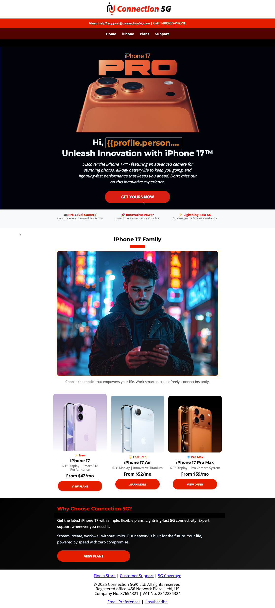

Sin embargo, el equipo de diseño normalmente le proporciona plantillas como esta:

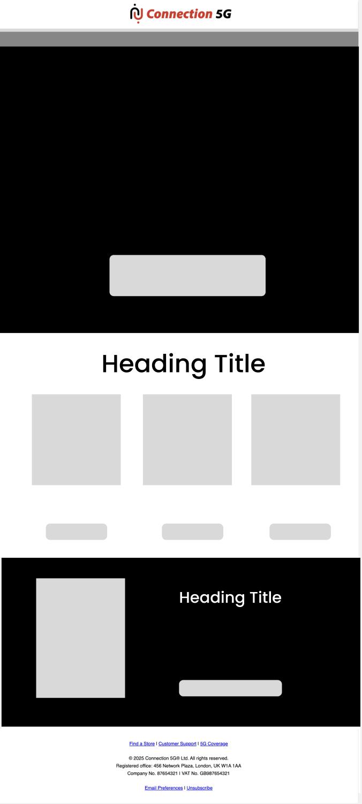

## Paso 1: Crear fragmentos de contenido

La siguiente plantilla es una plantilla de diseño genérica y nuestro objetivo es desglosarla en bloques de contenido repetibles. En Adobe recorrido Optimizer, esto se denomina **Fragmentos**.

El primer paso es identificar cuántos fragmentos necesitamos crear. En esta plantilla tiene sentido utilizar 5 fragmentos como se muestra a continuación.

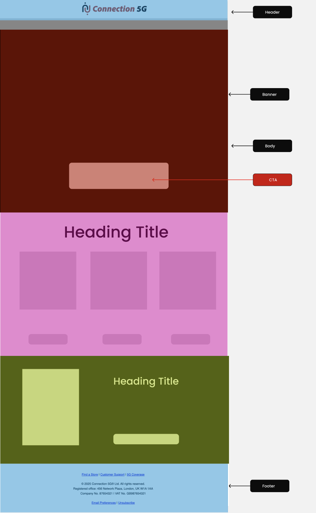

Hemos identificado las plantillas que requieren 5 fragmentos como se indica a continuación.

- Header
- Titular
- CTA
- Cuerpo
- Pie

>[!NOTE]
>
>Para este ejercicio, cree solo un fragmento de encabezado para ahorrar tiempo.

Cree un fragmento de encabezado para empezar. Sin embargo, antes de crear el fragmento, configure una carpeta de recursos ya que el entorno de recursos es compartido. Para ello, primero cree su propia carpeta.

1. En el panel de navegación izquierdo, localice la sección **Administración de contenido** y haga clic en **Assets**.

   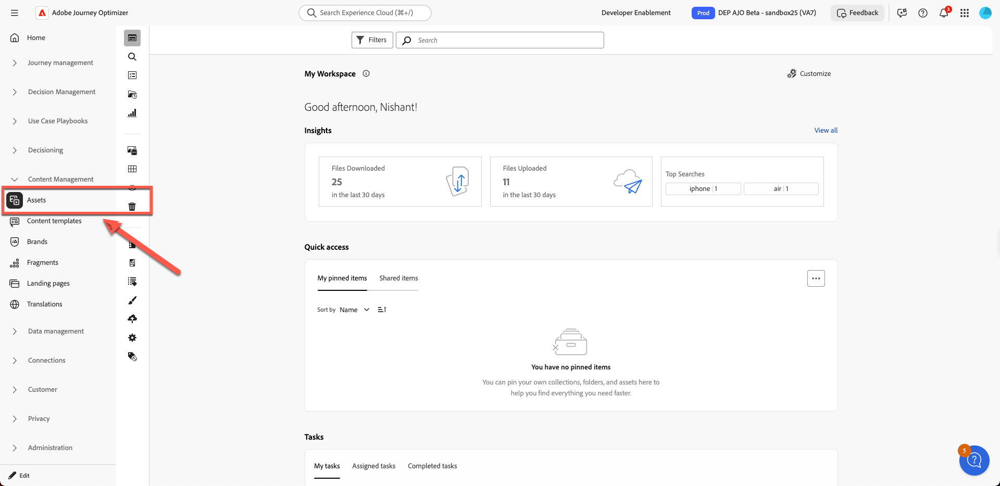

2. Haga clic en **Assets** en la sección Administración de Assets.

   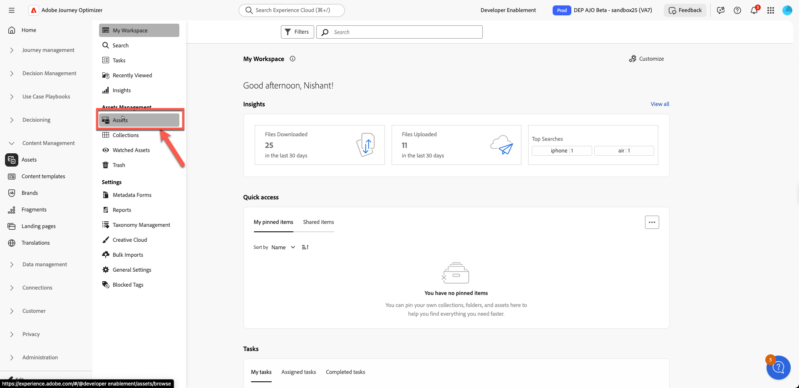

3. Cree una carpeta haciendo clic en el botón **&quot;Crear carpeta&quot;**.

   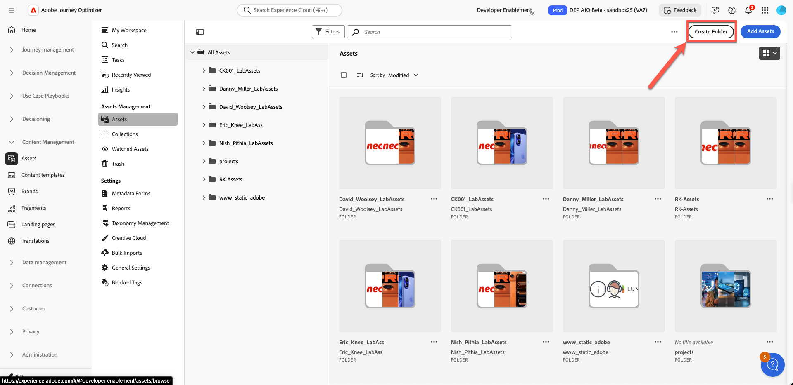

4. Dé un nombre como su nombre y apellido. p. ej. Nish\_Pithia\_LabAssets (Algo que puede recordar)

   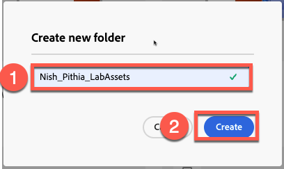

5. Haz doble clic en la carpeta recién creada para **abrirla**. Luego haz clic en **Agregar Assets** y busca o suelta todas las imágenes .png y .jpg de la carpeta del kit de herramientas. Luego haga clic en **Cargar**

   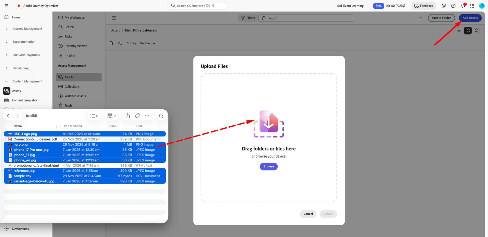

   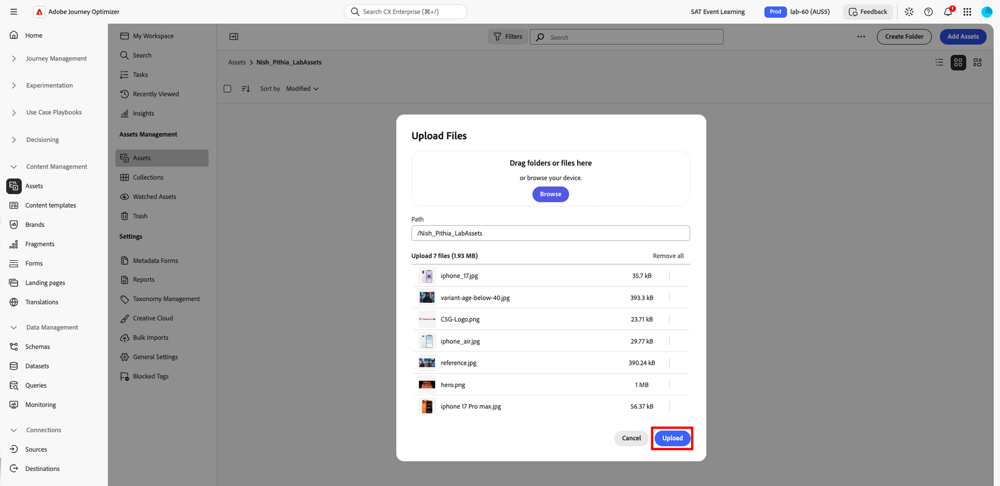

6. **Crear un nuevo fragmento:** En Administración de contenido, haga clic en **Fragmentos** y cree un nuevo fragmento.

   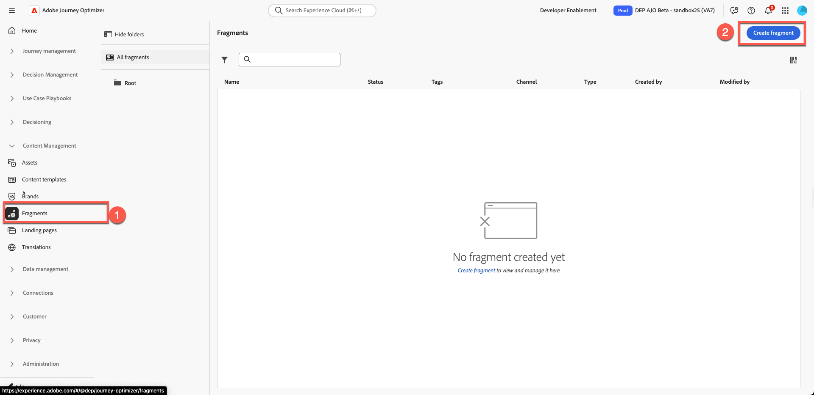

   Asigne un nombre descriptivo como se muestra a continuación. Añada todos los detalles como se indica a continuación:

   **Nombre:** encabezado

   **Descripción:** encabezado de fragmento para la plantilla

   **Tipo:** Seleccionar fragmento visual

   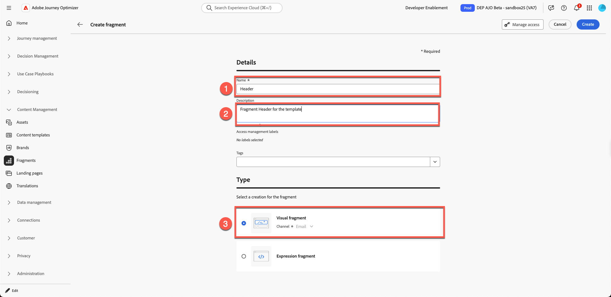

7. Haz clic en **Crear botón** en la parte superior derecha.

   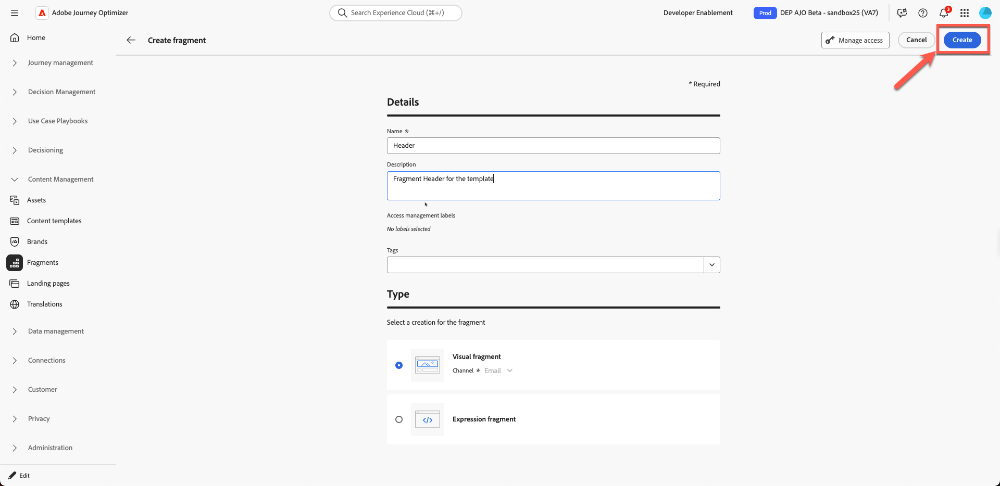

   Se abrirá una pantalla en blanco del creador de fragmentos.

8. Vaya a la ficha **Componentes** en la columna izquierda. A continuación, haga clic en la columna **1:1** debajo de Estructuras y arrastre en el lienzo como se muestra a continuación. (Haga clic en la imagen siguiente para ver un gráfico animado)

   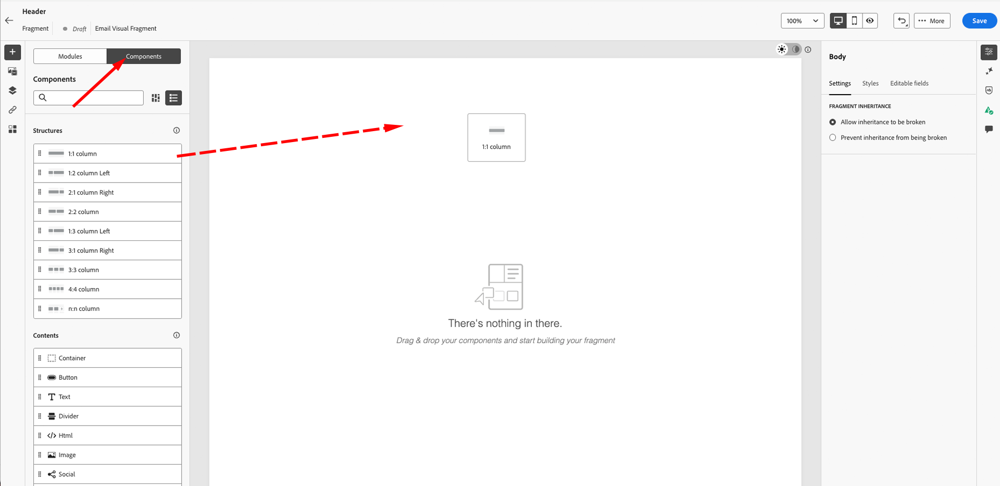

9. A continuación, arrastre &quot;**image**&quot; a la fila 1:1 que acabamos de agregar

   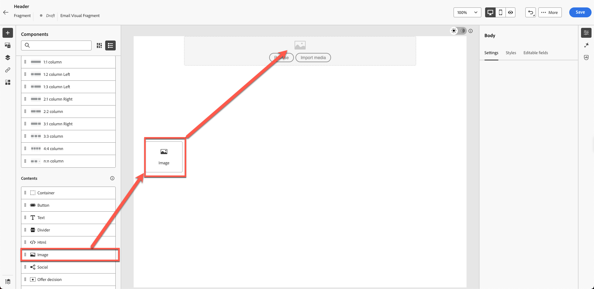

10. Haga clic en **&quot;Examinar&quot;** para seleccionar la imagen del logotipo que le han proporcionado y que ya ha subido a Assets.

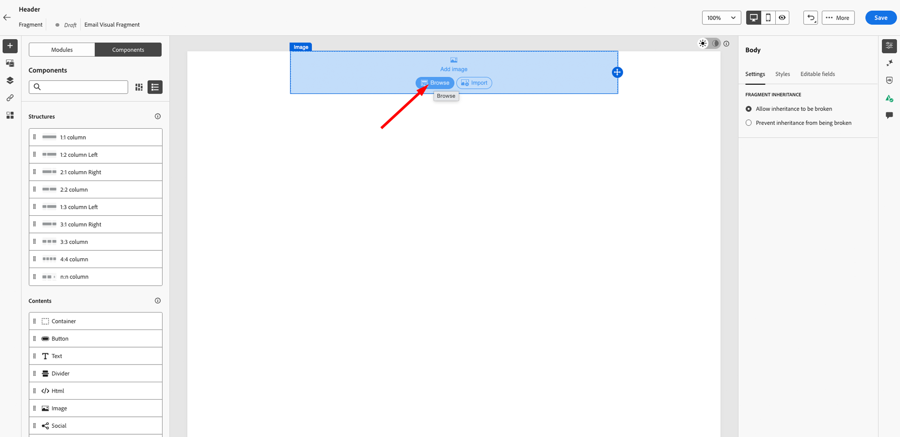

11. Vaya a la carpeta, haga clic en la imagen del logotipo (*C5G-Logo.png*) y haga clic en **Seleccionar**.

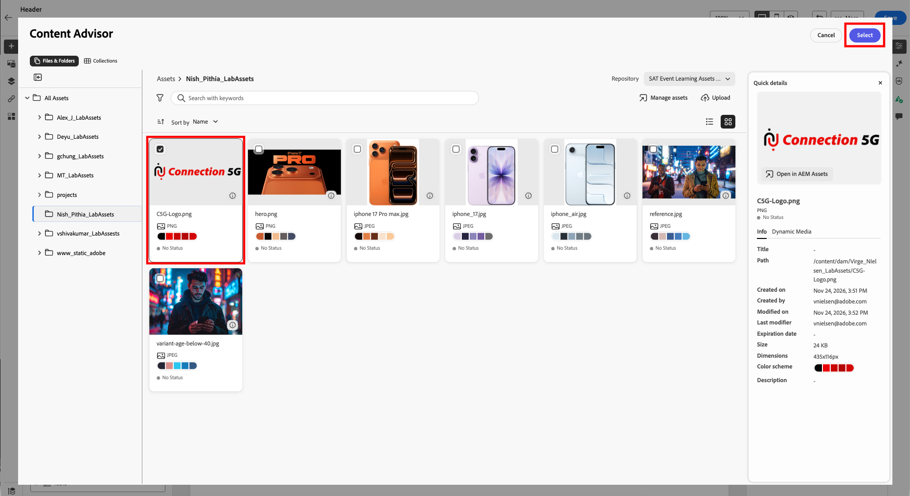

12. El logotipo está colocado correctamente, pero es demasiado grande y debe cambiarse de tamaño. Para cambiar el tamaño del logotipo, actualice sus propiedades. Haga clic en la ficha **Estilos** de la columna derecha y establezca el ancho en 40% arrastrando el control deslizante, como se muestra a continuación.

>[!NOTE]
>
>Tenga en cuenta que cuando el botón de alternancia está activado, el número 40 representa % y no píxeles. Si desea un valor absoluto de píxel perfecto, cambie el botón a píxeles.

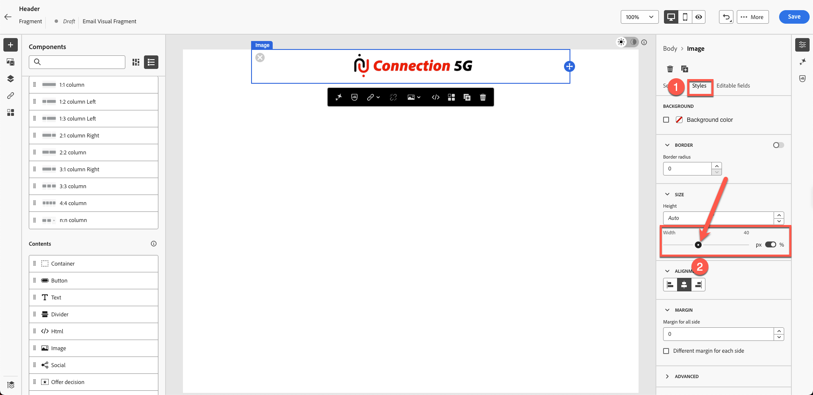

13. Haga clic en **&quot;Guardar&quot;** y se guardará el fragmento. Recibe una notificación de barra verde en la confirmación.

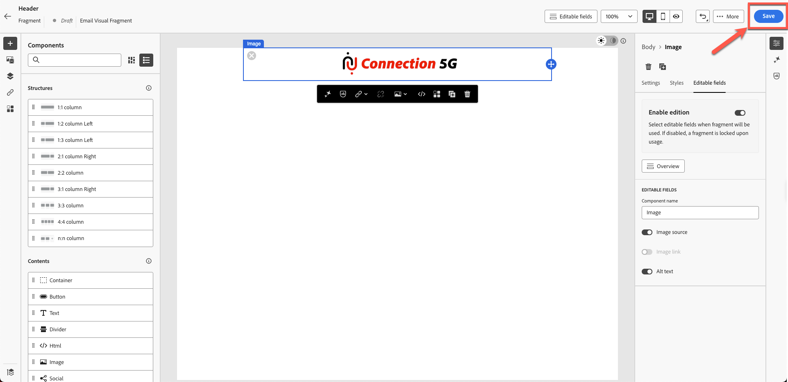

14. El fragmento guardado está en modo de borrador. Antes de usarlo, debe publicarlo. Haga clic en el botón **atrás**.

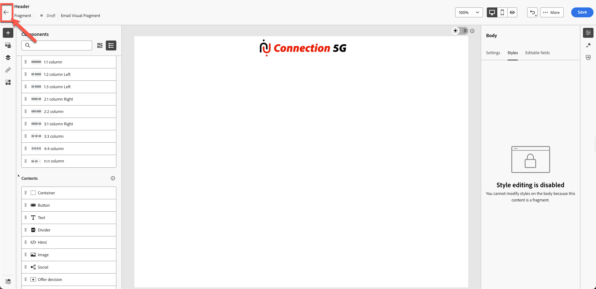

15. Haga clic en el botón &quot;**Publicar**&quot;. Verá el mensaje &quot;Publicando fragmento, esto puede tardar. Notificaremos una vez hecho&quot;. en la confirmación. El fragmento está listo para utilizarse para la creación de plantillas.

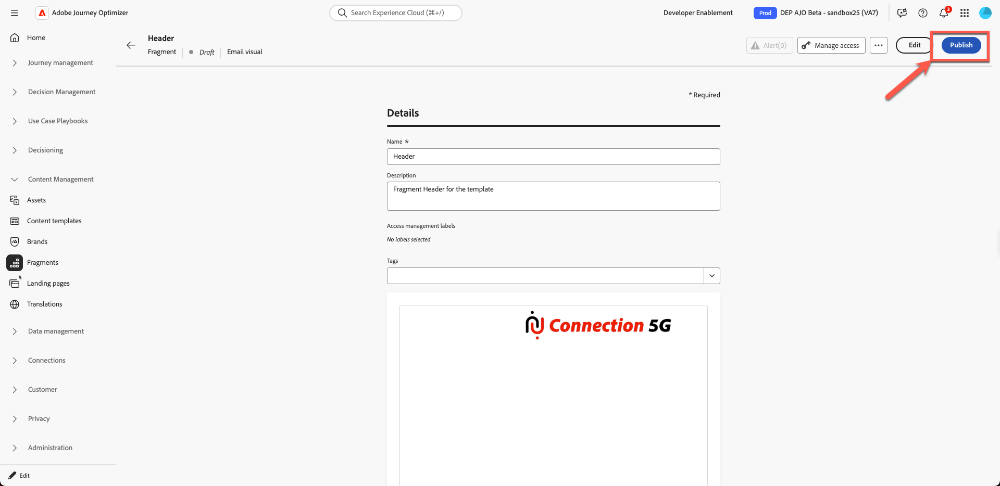

Verá el cambio de estado a **&quot;Activo&quot;**. En este punto, ha completado la creación de un fragmento de encabezado, que se utilizará en el siguiente paso.

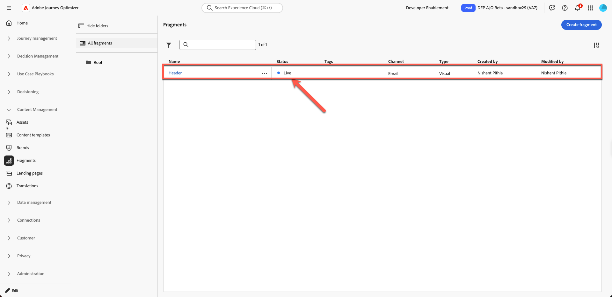

>[!NOTE]
>
>Tenga en cuenta que en este ejercicio solo ha creado un fragmento. En la práctica, los arquitectos pueden elegir crear varios fragmentos, como encabezados, pies de página u otros componentes reutilizables.

## Resumen

En este módulo ha realizado correctamente lo siguiente:

- Desglose de un correo electrónico en un fragmento de encabezado reutilizable
- Bloques de contenido de encabezado creados

Ya está listo para pasar al siguiente módulo: **Creación de una plantilla de contenido**, donde usará el fragmento que creó para generar una nueva plantilla.
