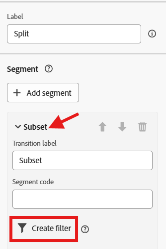
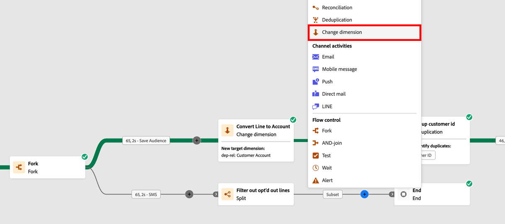
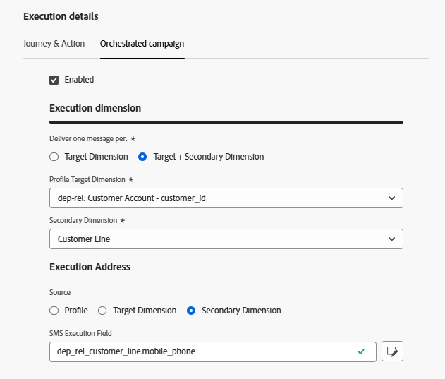

# Filtrar las líneas

## Objetivo

En el siguiente conjunto de pasos va a filtrar todas las líneas que realmente no pueden segmentarse con un mensaje SMS debido a su exclusión en el nivel de línea.  No puede confiar en el consentimiento del perfil aquí porque es un destinatario de nivel de línea.

## Configuración de la actividad División

1. Haga clic en el icono **+** en la transición inferior de la actividad Bifurcación y seleccione la actividad **Dividir** en la ventana emergente.

   

2. En el carril derecho, actualice Label para que indique lo siguiente: `Filter out opt'd out lines`

   

3. En el carril derecho, expanda la sección del segmento predeterminado **Subconjunto** y haga clic en el botón **Crear filtro**

   

4. Añada una condición para asegurarse de eliminar todas las líneas de cliente que no están incluidas en los mensajes SMS y, a continuación, haga clic en **Confirmar**.

   

   >[!NOTE]
   >
   >Debe averiguar cómo crear la condición, pero el resultado final coincide con la captura de pantalla anterior.  ¡Lo tienes!

5. Haga clic en el botón Save en la esquina superior derecha para guardar el trabajo.  El lienzo tiene el aspecto, así que ahora\...

## Añadir dimensión de cambio

1. En el lienzo del flujo de trabajo, haga clic en el icono **+** después de la condición de división que agregó y seleccione la actividad **Cambiar dimensión**

   

2. Actualice las propiedades de la dimensión de cambio como se describe a continuación y haga clic en **Confirmar**:
Etiqueta: `Convert Line to Account`
Nueva dimensión de destino: `dep-rel: Customer Account`

   

   

## Añadir la actividad SMS

1. Haga clic en el icono **+** después de la dimensión Cambiar que agregó y seleccione la **Actividad del mensaje móvil**

   

   

2. En el carril derecho, haga clic en el botón **Editar mensaje móvil** para iniciar la configuración del mensaje SMS

   

3. En la parte de navegación superior, haga clic en el elemento de menú Acciones y, a continuación, en la lista desplegable Configuración de mensajes de Mobile, seleccione el canal que ha creado anteriormente.

>[!CAUTION]
>
>¡Oh, no 🫨!  ¿Por qué no obtienes resultados?  ¿No has configurado ya tu canal SMS?  ¿Está roto el producto?
>
>¡QUÉ LOCO!!!!!!!!!

## Momento de asustar

La configuración de canal para SMS ya la había configurado usted de antemano y actualmente tiene este aspecto...

**La forma de leer esto es la siguiente:**

- Enviar un mensaje por la dimensión de destino (es decir, Cuenta del cliente) sobre el número de registros relacionados encontrados en la dimensión secundaria (es decir, Línea del cliente)
- Ejecute cada envío SMS con el número de teléfono móvil encontrado en la dimensión secundaria (es decir, Línea del cliente)

Esta capacidad única para enviar muchos mensajes a un perfil es una de las funciones principales de las campañas orquestadas, lo que las diferencia de los Recorridos. Sin embargo, la transición que lleva a la actividad de mensajería móvil está configurada en Cuenta de cliente. Esto le permite volver a unirlo al Perfil del cliente en tiempo real en el momento de la entrega, de modo que la información de entrega y seguimiento de los mensajes se atribuya a un perfil.

Entonces, ¿cómo hacer que esto funcione? Cambie el destino de la ejecución del mensaje para que coincida con la configuración del canal 😀

## Cambiar la configuración de Target y completar el mensaje SMS

1. Haga clic en el botón Atrás en la pantalla de edición de SMS

   

2. Con la actividad de mensaje móvil seleccionada, en el carril derecho cambie primero la opción de Target de la opción predeterminada de un mensaje por perfil a la opción **Un mensaje por dimensión secundaria** y, a continuación, haga clic de nuevo en **Editar mensaje móvil**

   

3. En la barra de navegación superior, haz clic en el elemento de menú **Acciones** y, a continuación, en la lista desplegable Configuración de mensajes de Mobile, selecciona el canal que creaste anteriormente.

   

## Resumen

Ha filtrado todas las líneas a las que no se permitía dirigirse con un mensaje SMS debido a la exclusión, ha cambiado la dimensión de línea a cuenta y, al final, ha configurado correctamente la actividad SMS para aquellos a los que se permitía dirigir.
Esperamos que también haya aprendido algo muy importante: **su destinatario debe coincidir con la configuración de canal que desee usar**
